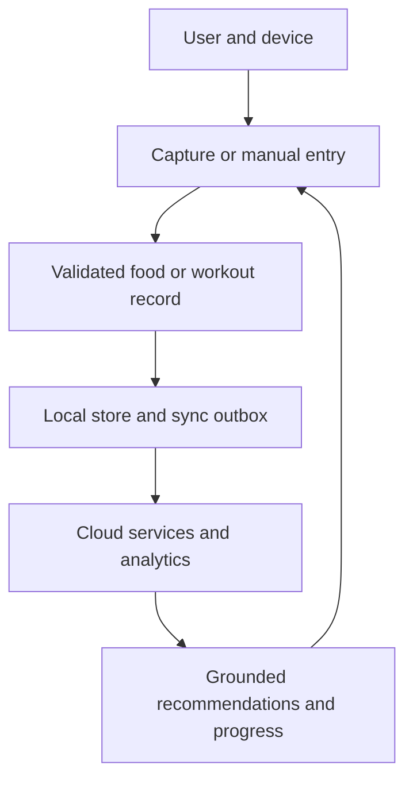
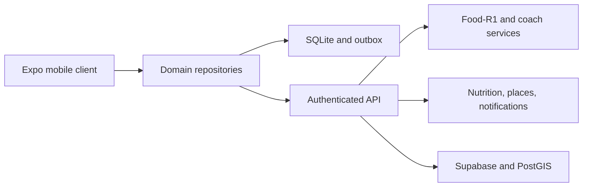

# ThriveLens 2026 Research Blueprint

## Project identity

**Project:** ThriveLens 2026 (Omni Fitness AI)  
**Programme:** Bachelor of Engineering - Artificial Intelligence and Machine Learning  
**Submitted by:** Thabang Masoabi (23BAI70376); Tinotenda Muzembe (23BAI70589); David Seola (23BAI70652); Chisomo Blessings Moleni (23BAI70696); Michael Bulis (23BAI70620)  
**Supervisor:** Sant Kumar Maurya (E13548)

**Document purpose.** This is a research-paper-ready technical blueprint and a machine-readable handoff for the complete ThriveLens system. It records the verified repository baseline, the Food-R1 training workstream, the previously agreed delivery plan, and the target implementation state in which the missing product capabilities have been delivered. It is not a claim that every target feature or model result already exists in the repository.

**Evidence status.** The repository audit is pinned to the public `main` snapshot at commit [`244b4bbe79b4e563df94af13affbe552d2f189b0`](https://github.com/bulismichael/-thrivelens-2026/commit/244b4bbe79b4e563df94af13affbe552d2f189b0), reviewed 8 September 2026. The Food-R1 notebook is a supplied local working artifact and had no saved execution outputs at the time of review. The completed-system sections are a counterfactual target specification: they describe what the team must have delivered and evidenced for the research paper to call ThriveLens complete.

## Abstract

ThriveLens is an offline-capable, cross-platform fitness and nutrition assistant that joins exercise planning, workout execution, food recognition, nutrition logging, progress analytics, grocery discovery, reminders, and grounded AI coaching in one user-scoped application. The product combines an Expo and React Native mobile client with a local SQLite/Drizzle persistence layer, authenticated Supabase services, spatial place search, external nutrition catalogues, and a Food-R1 vision-language model adapted for food analysis. The central research contribution is the integration contract: an image or barcode produces a candidate food observation, a human confirms the food and portion, a traceable nutrition provider supplies canonical nutrient values, deterministic arithmetic writes a meal record, and the resulting history becomes evidence for workout, meal, and coaching recommendations.

The machine-learning workstream uses supervised fine-tuning of `zy12123/Food-R1` with parameter-efficient QLoRA. The notebook supports a verified 302,157-record food dataset, group-safe splits, 4-bit NF4 double quantization, FP16 computation, frozen vision components, language-side LoRA adapters, DeepSpeed ZeRO-2, two-GPU distributed execution, gradient accumulation, checkpoint resume, verbose telemetry, and held-out structured-output evaluation. The application does not treat model text as nutrition truth: candidate recognition, portion confirmation, catalogue lookup, provenance, uncertainty, and user correction remain explicit stages. The paper must report measured model and product results only after a real GPU run, serving test, native-device test, database security test, and end-to-end acceptance cycle.

**Keywords:** multimodal learning; food recognition; nutrition estimation; parameter-efficient fine-tuning; QLoRA; LoRA; vision-language model; mobile health application; offline-first synchronization; spatial search; human-in-the-loop AI; reproducible evaluation.

## 1. Reading rules and evidence boundary

The blueprint uses three labels:

| Label | Meaning | How it may be written in the paper |
|---|---|---|
| Verified baseline | Directly observed in the repository, supplied notebook, or an official source | “The audited snapshot contains...” |
| Target complete state | The implementation that the project intends to deliver; assumed complete only for architecture and planning | “The completed-system design provides...” |
| Measurement gate | A result that must be generated by an experiment or test | “After execution, we report...” |

The current repository is a substantial UI prototype, not a verified production system. It contains working visual components, navigation, form state, animations, SVG charts, a video player, and local interaction state. It still contains simulated authentication, fixed food and coach responses, hardcoded dashboards and locations, a placeholder camera and map, an incomplete exercise catalogue, no matching Drizzle schema, no demonstrated Supabase authentication, no verified Food-R1 artifact, and no app inference bridge. The target sections below close those gaps conceptually and define their acceptance evidence.

The repository connection used for this review has read access to the public project. A collaborator's write permission was not independently verified. No source files are modified by this blueprint.

## 2. Mission, problem, and scope

### 2.1 Mission

ThriveLens helps a person make sustainable fitness and nutrition decisions using a single longitudinal record. It should reduce the friction between seeing food, understanding food, planning meals, shopping for ingredients, exercising, recording performance, and receiving useful coaching. The product is intended for worldwide food and exercise use; it is not restricted to one country, cuisine, or demographic.

### 2.2 Problem statement

Fitness and food applications often fragment the daily loop. A user may identify food in one tool, search nutrition data in another, plan exercise in a third, and lose history when offline. A visually polished interface without durable records cannot personalize recommendations or support scientific evaluation. ThriveLens addresses this by joining the following evidence chain:



### 2.3 In-scope capabilities

1. Account creation, sign-in, session restoration, sign-out, password reset, and optional OAuth.
2. Onboarding for identity, body measurements, goals, activity, equipment, dietary preferences, units, locale, and time zone.
3. Offline-first profiles, food logs, pantry, meal plans, shopping lists, workout plans, workout sessions, set records, progress, reminders, and conversation history.
4. Camera/photo food analysis, barcode lookup, manual search, portion correction, nutrition calculation, and meal logging.
5. Exercise discovery, exercise media, plan creation, actual set capture, session recovery, completion statistics, and progression suggestions.
6. Food and exercise coaching grounded in authorized records and validated application actions.
7. Worldwide grocery and gym discovery with explicit source, freshness, and coverage status; directions through the device navigation application.
8. Local notifications and, where operationally justified, server-originated push notifications.
9. Reproducible Food-R1 fine-tuning, evaluation, model serving, and model-version provenance.

### 2.4 Out of scope or explicitly bounded

- The model cannot infer exact portion mass, hidden ingredients, preparation method, allergens, or medical suitability from one photograph. Every estimate must be labelled and confirmable.
- A place record does not prove live stock, price, opening hours, quality, or safety. Those fields are nullable unless supplied by a verified provider.
- Workout progression is a transparent application rule, not an unvalidated medical or performance prescription.
- ThriveLens is not a diagnostic device, a substitute for a dietitian or clinician, or a source of emergency advice.
- A public mobile bundle must never contain model weights that exceed the supported device budget or a private inference token. The first release may use a secure inference service while an on-device model is evaluated separately.

## 3. Research objectives, questions, and hypotheses

### 3.1 Objectives

1. Build and evaluate a multimodal food-analysis pipeline that returns structured, traceable candidates rather than unconstrained text.
2. Demonstrate that an offline-first data layer preserves user continuity across restarts, network loss, retries, and account changes.
3. Measure whether the integrated daily loop produces correct nutrition totals, workout totals, and place handoffs from saved records.
4. Establish a reproducible two-GPU training and serving protocol within the stated Kaggle budget, without early stopping in the fixed-epoch training run.
5. Define privacy, security, safety, and operational evidence strong enough for a responsible consumer release.

### 3.2 Research questions

| ID | Question | Primary measure |
|---|---|---|
| RQ1 | How accurately can Food-R1 identify food candidates and produce the required structured fields across worldwide, multi-source images? | Per-task exact match, token F1, JSON validity, ingredient set F1, numeric MAE/RMSE/MAPE, calibration and abstention quality |
| RQ2 | Does the human-confirmed catalogue pipeline reduce nutrition logging error relative to unconstrained model output or manual baseline? | Confirmed food accuracy, portion correction rate, nutrient error, completion time, unresolved/abstained rate |
| RQ3 | Does durable offline persistence preserve user state and produce correct cross-screen summaries? | Restart recovery, offline mutation survival, sync idempotence, cross-account isolation, known-answer totals |
| RQ4 | Can the reproducible fixed schedule complete within the available dual-T4 budget without reducing the acceptance quality of validation and held-out evaluation? | Throughput, optimizer steps, GPU utilization, memory, run time, finite losses, evaluation coverage, artifact integrity |
| RQ5 | Can grounded AI suggestions be converted into safe, user-approved workout or meal actions? | Groundedness, invalid-action rejection, approval rate, duplicate-write rate, unsupported-claim rate |

### 3.3 Hypotheses

- H1: QLoRA adaptation of Food-R1 will improve food-domain structured-output metrics over the unadapted checkpoint on the untouched test split, subject to the chosen task mix and leakage controls.
- H2: Separating recognition from catalogue lookup, portion confirmation, and deterministic arithmetic will reduce nutrient error and make failures diagnosable compared with accepting generated nutrient values directly.
- H3: An outbox with idempotent operations and version checks will preserve records through offline and retry scenarios without double counting.
- H4: A versioned, tool-constrained coach will produce fewer unsupported actions than a free-form chat endpoint while retaining useful personalization.

Hypotheses are not results. Confidence intervals, baselines, ablations, and failure examples must be added after execution.

## 4. Verified repository baseline

### 4.1 Repository inventory

The audited GitHub snapshot is [`bulismichael/-thrivelens-2026`](https://github.com/bulismichael/-thrivelens-2026) on `main`, commit `244b4bb` (8 September 2026). The application is under `omni-fitness-ai/`. The tree contains 92 items, including 63 text-like files and binary assets. The root `README.md` is still Expo starter text, so this blueprint and an updated project README are part of release documentation.

### 4.2 Current stack

| Layer | Verified technology or artifact | Current role |
|---|---|---|
| Mobile runtime | Expo SDK 57, React Native 0.86.3, React 19.2.3 | Cross-platform client |
| Routing | Expo Router 57 | File-based routes and tab layout |
| Styling | NativeWind 4, Tailwind CSS 3 | Utility styling alongside token components |
| Motion and graphics | Reanimated 4, react-native-svg, lucide-react-native | Animations, charts, icons |
| Device features already listed | expo-video, expo-image-picker, expo-auth-session, expo-secure-store, expo-notifications | Some are used; others are only installed |
| Local data dependency | Drizzle ORM and expo-sqlite | Configured/planned; `src/db/schema.ts` is absent in the audited tree |
| Cloud dependency | `@supabase/supabase-js` | Installed but not wired to auth or data flows |
| ML legacy path | TensorFlow/Keras MobileNetV2 and TFLite export | Separate planned classifier under `ml/food_classifier`; not Food-R1 integration |
| ML active path | Food-R1 notebook and pinned Qwen-VL trainer | Supplied training workstream outside the mobile source tree |

The audited package manifest does not include `expo-camera`, `expo-location`, or `react-native-maps`. The target architecture uses a native map build and camera/location packages deliberately rather than assuming that an installed dependency is integrated.

### 4.3 Feature status and release risk

| Area | Verified baseline | Target correction |
|---|---|---|
| Auth and routes | Sign-in/sign-up use timers; OAuth and password reset controls are empty; root routing returns to welcome; no session guard | Supabase Auth, session listener, protected groups, account switching, reset flow, real callbacks |
| Onboarding | Multi-step state is collected locally; calorie/protein fields are not correctly bound; completion is not persisted | Persist validated profile/preferences and derive editable targets with units/time zone |
| Home and analytics | User, workout, nutrition, weekly statistics, charts, and strength progression are fixed values | Typed repositories and date-scoped queries from saved records |
| Food scanner | Hardcoded chicken/rice/vegetable sample; emoji camera placeholder; no barcode or model call | Camera/photo/barcode capture, secure inference, catalogue resolution, editable portion, confirmed log |
| AI coach | One hardcoded response after a timer; duplicate static AI Couch tab | Versioned coach service with retrieval, tools, validation, approval, and observable failures |
| Workouts | Two hardcoded exercises; Complete Set only starts a timer; Add Set has no handler; state is lost on exit | 300-plus catalogue, set-level records, resume/abandon/finish, progression and analytics |
| Nutrition | Static meals and macro rings; meal plans and kitchen actions are inactive | Food logs, targets, pantry, recipes, plans, substitutions, shopping lists |
| Maps | Four fake locations and a placeholder map; directions are decorative; no grocery category | Real native map, location/manual search, sourced POIs, PostGIS radius queries, directions |
| Database and security | Ten SQL tables; all explicitly disable row-level security; password hash field appears in application table | Supabase Auth identity, RLS policies, migrations, local Drizzle schema, privacy tests |
| Exercise assets | One exercise JSON record; referenced video is absent | Reviewed stable catalogue, coverage report, valid media or honest text fallback |
| Notifications | Dependency/plugin presence but no scheduling code | Permission-aware local reminders and optional server push |
| Quality | No test script and no verified device/build evidence in the audit | Unit, integration, E2E, security, accessibility, performance, backup/restore evidence |

Source evidence includes [`project.md`](https://github.com/bulismichael/-thrivelens-2026/blob/244b4bbe79b4e563df94af13affbe552d2f189b0/project.md), [`my-ui.md`](https://github.com/bulismichael/-thrivelens-2026/blob/244b4bbe79b4e563df94af13affbe552d2f189b0/my-ui.md), [`package.json`](https://github.com/bulismichael/-thrivelens-2026/blob/244b4bbe79b4e563df94af13affbe552d2f189b0/omni-fitness-ai/package.json), the route files under [`src/app`](https://github.com/bulismichael/-thrivelens-2026/tree/244b4bbe79b4e563df94af13affbe552d2f189b0/omni-fitness-ai/src/app), [`exercises.json`](https://github.com/bulismichael/-thrivelens-2026/blob/244b4bbe79b4e563df94af13affbe552d2f189b0/omni-fitness-ai/src/data/exercises.json), and [`supabase/schema.sql`](https://github.com/bulismichael/-thrivelens-2026/blob/244b4bbe79b4e563df94af13affbe552d2f189b0/omni-fitness-ai/supabase/schema.sql).

### 4.4 Screen and component map

| Route or file | Verified responsibility | Target completion |
|---|---|---|
| `index.tsx`, `_layout.tsx` | Root redirect and stack route declarations | Session-aware protected groups and an authenticated home destination |
| `welcome.tsx` | Animated welcome and feature cards | Keep visual treatment; link to real auth and accessible first-run states |
| `signup.tsx`, `signin.tsx` | Validated forms with simulated delay | Supabase Auth, OAuth callbacks, reset, errors, loading, session restore |
| `onboarding.tsx` | Five-step local form state | Persist profile, units, locale, time zone, preferences, targets, and consent |
| `(tabs)/index.tsx` | Home greeting, workout/nutrition cards, weekly statistics | Repository-backed daily summaries and honest empty/offline/error states |
| `(tabs)/workout.tsx` | Workout cards and category controls | Plan CRUD, real catalogue filtering, AI proposal approval, saved sessions |
| `exercise-library.tsx`, `exercise-detail.tsx` | Search/filter and video detail | 300-plus reviewed records, valid media or text fallback, source metadata |
| `active-workout.tsx`, `workout-complete.tsx` | Local exercise/set UI, timer, completion view | Set-level persistence, resume/background recovery, derived completion statistics |
| `(tabs)/tracking.tsx` | SVG weight/calorie charts and static strength cards | Date-scoped progress queries, measured/estimated labels, known-answer totals |
| `(tabs)/nutrition.tsx` | Macro rings, meal cards, kitchen/plan actions | Food logs, targets, pantry, recipes, plans, shopping lists, deterministic totals |
| `food-scanner.tsx` | Sample results and camera placeholder | Camera/photo/barcode capture, Food-R1 candidate result, confirmation and log |
| `ai-coach.tsx`, `(tabs)/ai-couch.tsx` | Modal chat and separate static AI tab | One canonical coach route with grounded actions and approval |
| `(tabs)/maps.tsx` | Four hardcoded places and map placeholder | Native map, location/manual search, sourced POIs, grocery filters and directions |
| `profile.tsx` | Local avatar picker and fixed profile/settings | Authenticated profile, preferences, export, deletion and sign-out |
| `src/components/ui/*` | Button, Card, Input, Text, Avatar, Progress, PressableScale | Preserve variants; add async, disabled, focus, error, and accessibility states |
| `src/theme/*` | Color, spacing, typography, shadow, radius and motion tokens | Preserve token governance and document contrast/reduced-motion decisions |

## 5. Target system architecture

The complete product is organized as six contracts rather than as screens that directly call providers:

1. **Presentation contract:** typed screen state, loading/empty/error states, accessible controls, and navigation guards.
2. **Domain contract:** user, food, meal, pantry, workout, set, progress, place, reminder, and coach action types.
3. **Persistence contract:** local SQLite records, cloud rows, migrations, operation IDs, versions, tombstones, and sync status.
4. **Service contract:** authenticated API requests, validation, rate limits, request IDs, timeouts, model/provider versions, and structured errors.
5. **Model contract:** image or text input, candidate foods, uncertainty/abstention, structured outputs, and model provenance.
6. **External-data contract:** Open Food Facts, USDA FoodData Central, OpenStreetMap/Overpass, map tiles/geocoding, and device navigation.

### 5.1 Runtime data flow



The mobile app renders only domain records and explicit operation states. It never directly trusts generated nutrient values, user IDs supplied by the client, third-party place ratings, or unvalidated exercise IDs. All side effects flow through repositories or service adapters so they can be tested with fixtures and replaced without rewriting screens.

### 5.2 Target module layout

```text
omni-fitness-ai/
  src/
    app/                         Expo Router screens and protected groups
    components/ui/               reusable token-driven components
    theme/                       color, type, spacing, radius, shadow, motion tokens
    db/                          Drizzle schema, migrations, SQLite connection
    domain/                      zod/typescript entities and invariants
    repositories/                profile, food, workout, progress, place, coach repos
    services/                    auth, sync, inference, catalogue, maps, notifications
    state/                       session, profile, pending operations, UI state
    lib/                         pure calculations and platform adapters
  assets/                        app imagery, reviewed exercise media, labels
  supabase/                      versioned migrations, RLS policies, edge functions
  ml/food_classifier/            legacy TFLite experiment, explicitly separate from Food-R1
  docs/                          contracts, runbooks, model card, evaluation reports
```

## 6. Data, identity, and offline persistence

### 6.1 Identity and authorization

Supabase Auth is the identity authority in the target system. Application profiles reference the Auth user UUID; passwords are never stored in the application table. Access tokens are stored through the platform secure-store adapter, refreshed by the session listener, and removed on sign-out. A protected Expo Router group redirects only after the session state is known, so a cold start cannot flash private screens.

Every exposed table has row-level security enabled with policies based on `auth.uid()`. Parent-child records are protected transitively: a user cannot read a workout set merely because it knows a child ID. Service-role credentials exist only in server functions. The current SQL's explicit `disable row level security` statements are a P0 release blocker; they are not acceptable as the final security posture. Supabase documents RLS as the granular authorization layer for exposed schemas and recommends policies, grants, tests, and migrations.[R4]

### 6.2 Local and cloud responsibilities

SQLite is the local source for responsive reads and pending offline mutations. Supabase is the durable multi-device source after synchronization. The two schemas are versioned independently but share domain contracts. A local SQLite database is not assumed to synchronize automatically.

Each mutable record includes `id`, `user_id`, `created_at`, `updated_at`, `version`, `deleted_at` (or a tombstone), and `sync_state`. Each mutation includes a stable `operation_id`, entity ID, operation type, base version, payload, and retry metadata. The server accepts an operation once, rejects unauthorized user IDs, and returns a conflict or the authoritative record when versions diverge. The initial conflict policy is field-aware last-write-wins only for low-risk preferences; logs and set records are append-oriented and never silently overwritten.

### 6.3 Target domain entities

| Bounded context | Target entities and important fields |
|---|---|
| Identity | `auth.users`; `profiles` with units, locale, time zone, age band, height, weight, goal, activity, experience, onboarding state, consent |
| Food catalogue | `food_sources`, `food_catalog` with provider IDs, barcode, language, nutrient basis, serving units, freshness, allergen/source metadata |
| Food logging | `food_logs` with candidate ID, confirmed catalogue ID, portion quantity/unit, nutrient snapshot, meal/date, image reference, model revision, user correction |
| Kitchen and planning | `pantry_items`, `recipes`, `recipe_ingredients`, `meal_plans`, `meal_plan_items`, `shopping_lists`, `shopping_list_items` |
| Exercise | `exercises`, `exercise_media`, reviewed instructions, equipment, difficulty, body part, provenance, stable IDs |
| Workout | `workout_plans`, `workout_days`, `workout_exercises`, `workout_sessions`, `workout_sets` with reps, load, unit, completion, exertion and timestamps |
| Progress | `progress_logs`, derived summaries, measurement source/state (`measured`, `estimated`, `unavailable`) |
| Places | `place_cache` with provider/type/source ID, geometry, name, address, freshness, attribution, nullable ratings/hours |
| Engagement | `reminder_preferences`, `device_tokens`, notification records, delivery state |
| AI | `ai_conversations`, `ai_messages`, `ai_actions` with source record IDs, validation status, approval state, model/service revision |
| Operations | `sync_outbox`, `consents`, `audit_events`, export/deletion jobs |

The audited ten-table SQL file is a starting point, not the final data model. In particular, one `workout_logs` row cannot provide reliable partial-session recovery in the same way as separate set records, and `food_logs` needs a source and portion basis to make old totals reproducible.

### 6.4 Privacy and data lifecycle

Photos are private objects with short-lived signed access, explicit retention, deletion on user request, and no accidental inclusion in analytics exports. Exports contain user records and source/model versions; account deletion removes cloud rows, local caches, pending operations, and stored media after a documented retention job. Telemetry is minimized, pseudonymized, and never used to reconstruct food or health records without consent.

## 7. Food-R1 training and model engineering

### 7.1 Model identity and role

The active custom training track is the public [`zy12123/Food-R1`](https://huggingface.co/zy12123/Food-R1) checkpoint, identified as a Qwen3-VL model with an Apache-2.0 model card and BF16 weights at the time of review.[R6] Food-R1 is a vision-language component for food analysis. It is not, by itself, a nutrition database, a portion scale, a medical authority, or a mobile application.

### 7.2 Dataset lineage

The training notebook describes a verified 302,157-record worldwide food dataset with the following split contract:

| Split | Records | Use |
|---|---:|---|
| Train | 242,756 | Supervised fine-tuning only |
| Validation | 6,460 | Complete validation after each epoch and diagnostics |
| Test | 52,941 | Untouched held-out generation/evaluation |
| Total | 302,157 | Audit and provenance total |

The manifest reports source counts of 107,794 Open Images food crops, 183,893 Fruits360 records, and 3,490 Nutrition5K supervised dishes. The data audit requires unique IDs, required conversations, matching `<image>` tokens and media URIs, answer tags, valid JSON tasks, existing `zip://` members, and group-safe split assignment. Representative RGB decode checks are run before training.

There is an unresolved archive provenance discrepancy: an earlier supplied archive summary used SHA-256 `6c5320da2316117583e82516fa4431986b4dc36117efec8aafa9e0779e68961e`, while the notebook's expected hash is `4c378fc53d427fff808a2bfee7d923d5569355fd3794b5ffd5bfc3a4115d7f49`. The paper must name the exact archive, byte size, entry count, hash, and manifest used by the successful run. Until that is resolved, the two hashes must not be presented as interchangeable.

Food2K is a relevant external research benchmark: its paper introduces over one million images in 2,000 categories and reports benefits for food recognition, retrieval, detection, segmentation, and other food tasks.[R7] It should be treated as an additional pretraining or external-evaluation resource only when its distribution, licensing, labels, and use in the actual run are recorded. The current notebook's 302,157-record dataset is not silently relabelled as Food2K.

### 7.3 Notebook techniques used

The supplied `ThriveLens_FoodR1_Dual_T4_QLoRA_A_Grade_Verified_302157.ipynb` contains a 30-cell, staged experiment:

| Technique | Notebook implementation | Reason |
|---|---|---|
| Reproducible stages | UTC banners, elapsed time, flushed JSON reports, traceback capture | Every phase is visible and diagnosable |
| Input validation | Exact path discovery, archive/hash/CRC checks, manifest checks, JSONL audit, image decode audit | Prevent silent data corruption and leakage |
| Memory-efficient adaptation | 4-bit NF4, double quantization, frozen base, LoRA adapters | Fit a large vision-language model on T4 memory |
| Distributed execution | `torchrun`, two visible CUDA devices, NCCL all-reduce smoke test, DeepSpeed ZeRO-2 | Use both GPUs and detect rank failures early |
| Optimizer and schedule | Paged 8-bit AdamW, cosine scheduler, 5 percent warmup, weight decay, gradient clipping | Control memory and stabilize adaptation |
| Activation memory | Gradient checkpointing with `use_reentrant=False` | Reduce activation memory at extra compute cost |
| Adapter scope | Rank 64, alpha 16, dropout 0.05, `all-linear`, excluding `lm_head`, `embed_tokens`, and visual spans; vision tower and merger frozen | Keep trainable capacity in language-side linear layers |
| Precision | FP16 compute; BF16 and TF32 disabled in the recorded contract | Match the T4 runtime contract |
| Data loading | Raw ZIP or extracted mode, per-process cached ZIP handles, image pixel range 256x256 to 768x768, four workers, pinned/persistent loader | Avoid duplicating a multi-gigabyte image archive |
| Fixed run policy | Three epochs, no early stopping, epoch validation, step checkpoints, retained checkpoint limit | Honor the requested fixed schedule and preserve evidence |
| Reliability | Dual-GPU smoke training, checkpoint compatibility checks, resumable full run, adapter integrity report | Prevent wasting the compute window on an invalid full run |
| Reporting | Tensor/parameter summary, losses, learning rate, grad norm, GPU/CPU/RAM telemetry, CSV/plots, run manifest | Make the run auditable |
| Evaluation | Deterministic generation, distributed test sharding, exact match/token F1, JSON validity, ingredient set metrics, numeric MAE/RMSE/MAPE, failures | Measure structured food tasks rather than prose fluency |

The foundational papers support the method choices: LoRA freezes pretrained weights and injects low-rank trainable matrices; QLoRA backpropagates through a frozen 4-bit model and adds NF4, double quantization, and paged optimizers; ZeRO reduces optimizer and parameter redundancy across distributed training.[R1][R2][R3]

### 7.3a Notebook cell-to-evidence map

The notebook is intentionally staged so that a failure identifies a bounded contract instead of silently corrupting a long run. Cells 0, 8, 18, 23, and 27 are section markdown; the executable cells are summarized below.

| Cells | Evidence produced |
|---|---|
| 1-2 | Stage logger, streamed subprocess/telemetry helpers, and one configuration contract |
| 3-4 | Kaggle/CUDA/disk checks, exact archive or extracted-data discovery, hash/CRC/member checks, runtime media environment |
| 5-7 | Manifest split/source/task checks, JSONL schema/leakage audit, representative RGB decode audit |
| 9-10 | Pinned package installation, version assertions, bitsandbytes CUDA diagnostic, DeepSpeed report |
| 11-12 | Pinned Qwen-VL trainer patch/compile/fingerprint, model/processor architecture and token/image audit |
| 13-14 | Two-rank NCCL all-reduce check and safe DeepSpeed command/contract builder |
| 15-16 | Task-stratified smoke manifests and dual-GPU smoke training with adapter/model-summary checks |
| 17 | Checkpoint compatibility, safe resume/import contract, and duplicate-run avoidance |
| 19-20 | Full three-epoch dual-T4 run, fixed no-early-stop completion and run manifest |
| 21-22 | Loss/learning-rate/gradient diagnostics and adapter safetensors/config integrity |
| 24-26 | Self-contained distributed evaluator, all-test held-out run, task metrics, failure/prediction files and quality report |
| 28-29 | Reproducible delivery archive/checksum and final acceptance checklist |

### 7.4 Exact recorded configuration

The current notebook's Cell 02 is the single source of truth for that notebook run:

| Group | Recorded value |
|---|---|
| Model | `zy12123/Food-R1` |
| Epochs and stopping | `EPOCHS=3`; `EARLY_STOPPING=False`; no best-model replacement |
| Batch | micro-batch 1 per GPU; gradient accumulation 8; world size 2; global effective batch 16 |
| Optimization | paged AdamW 8-bit; learning rate `2e-4`; cosine; warmup `0.05`; weight decay `0.01`; betas `(0.9, 0.999)`; epsilon `1e-8`; max grad norm `0.3` |
| Quantization | load in 4-bit; NF4; double quantization; FP16 compute |
| LoRA | rank 64; alpha 16; dropout 0.05; all-linear targets; bias none; visual/merger/vision frozen; DoRA false |
| Context and images | maximum sequence length 2,048; pixels 65,536 to 589,824 |
| Data | 242,756 train; 6,460 validation; 52,941 test |
| Checkpoints/logging | save every 1,000 optimizer steps; retain 4; log every 10; validate each epoch |
| Loader | four workers; prefetch 2; pinned memory; persistent workers |
| Generation | all test records when `MAX_TEST_SAMPLES=0`; maximum 512 new tokens; greedy/no sampling/one beam |
| Runtime | Kaggle T4 x2; `CUDA_VISIBLE_DEVICES=0,1`; ZeRO-2; NCCL; telemetry every 60 seconds |

The notebook also contains an earlier budget-oriented planning variant recorded in project context: a deterministic balanced 96,000-record manifest, 6,000 optimizer steps, global batch 16, LoRA rank 32, frozen vision components, 1,536-token ceiling, task-aware 128-384 pixel range, and 2,000 held-out generations. That variant is not the same experiment as the 302,157-record, three-epoch Cell 02 contract. The paper must choose one executed configuration, preserve its manifest and run hash, and describe the other as an ablation or budget plan.

### 7.5 Runtime and 30-hour budget protocol

The fixed no-early-stopping policy is preserved, but a fixed schedule is not a promise of completion time. The safe protocol is:

1. Run the package, data, NCCL, and two-step smoke gates before consuming the full run budget.
2. Measure real examples/second and optimizer steps/second on the exact dataset and pixel range. Estimate the training window from measured throughput, not a theoretical GPU specification.
3. Save resumable checkpoints and a run manifest every checkpoint interval. Do not delete the last known-good checkpoint until the next one is validated.
4. If the weekly budget expires, resume from the compatible checkpoint in the next window; report the achieved fixed-epoch state honestly.
5. Treat the 52,941-record held-out generation as a separate budgeted job if it cannot fit after training. Do not replace it with a tiny sample while claiming full-test evaluation.

The budget protocol changes scheduling, not quality criteria: validation remains complete for the selected split, early stopping remains disabled, and the final paper reports the actual number of examples, optimizer steps, epochs, and test records processed.

### 7.6 Model evaluation and serving handoff

The evaluator shards the untouched test split across both GPUs. It records per-task results, valid/invalid JSON, exact match and token F1, ingredient precision/recall/F1, numeric field error, failures, representative predictions, and telemetry. Recommended additions before publication are confidence calibration, abstention/uncertainty thresholds, source-balanced metrics, bootstrap confidence intervals, duplicate-image checks, and a human review subset for ingredients, portions, and nutrient plausibility.

The release artifact must contain the base model revision, adapter safetensors, processor/tokenizer revision, dataset manifest and hash, preprocessing code hash, dependency lock, training configuration, checkpoint provenance, held-out metrics, failure examples, and a reproducible inference command. The serving API returns `model_revision`, `request_id`, `candidate_status`, `confidence_or_abstention`, and source references with every analysis.

### 7.7 Legacy MobileNetV2/TFLite path

`ml/food_classifier/train.py` is a separate legacy experiment. It uses ImageNet-pretrained MobileNetV2, 224x224 images, directory-based validation, random flip/rotation/zoom, a 128-unit dense head with dropout, Adam at `1e-3`, sparse categorical cross-entropy, ModelCheckpoint, EarlyStopping, ReduceLROnPlateau, and TFLite conversion. It is not evidence that Food-R1 has been trained or can run on-device. The paper should present it as an earlier baseline/prototype only if it is actually executed and evaluated; otherwise list it as historical code retained for comparison.

## 8. Food capture, nutrition truth, and meal planning

### 8.1 Capture-to-log sequence

1. Ask for camera, photo-library, or barcode permission with a useful denied state.
2. Capture an image, upload a selected image, or scan a barcode. Generate a request ID and enforce size/type limits.
3. Send the request through the authenticated service boundary. The app does not call a private provider token directly.
4. Food-R1 returns one or more candidates, structured fields, confidence/abstention, and model revision. It does not write a meal log.
5. The user selects or rejects a candidate and edits name, serving, quantity, unit, and meal time.
6. Resolve a canonical product or generic food through the catalogue adapter. Show source, nutrient basis, missing fields, and freshness.
7. Recompute calories and macros deterministically from the confirmed nutrient snapshot and portion. Preserve the calculation inputs in the log.
8. Save locally and queue a sync operation. Update nutrition rings and home totals from the saved record.

This separation is the principal anti-hallucination control in the product. The recognition result is an observation; the confirmed log is a user decision backed by a nutrition source.

### 8.2 Nutrition providers

Open Food Facts is suitable for packaged/barcoded products and publishes API documentation, rate limits, and bulk data guidance. Its API documentation advises caching and using downloadable data for larger workloads.[R5] USDA FoodData Central supplies generic food and nutrient records; API use requires a data.gov key, has default rate limits, and the key must remain private.[R8] The target adapter stores provider IDs, nutrient basis (for example, per 100 g or per serving), units, language, update date, and missing nutrient status. A server-side cache prevents every mobile scan from becoming a provider request.

### 8.3 Targets, recipes, pantry, and shopping list

Onboarding values feed a transparent BMR/TDEE estimate with an editable goal adjustment. The UI labels the result as an estimate and lets the user override it. Meal plans reference canonical foods and recipes, not untraceable generated strings. Pantry quantities and expiry states subtract from required ingredients, normalize units, deduplicate items, and expose missing conversions.

An AI meal plan is a proposal. The domain layer rejects unknown food IDs, impossible units, unsupported dietary constraints, and nutrient totals that do not reconcile. The user approves before records are created. A shopping list opens grocery discovery with the selected ingredients as context, not as a claim that any store has stock.

## 9. AI coach and personalization

### 9.1 Secure service boundary

The app sends an authenticated request to a versioned service with `request_id`, user-scoped context identifiers, bounded message length, timeout, retry policy, and a structured error. Inference credentials are server-side. The existing `EXPO_PUBLIC_HF_TOKEN` guidance in the legacy ML README must be removed; public Expo variables are bundle-visible and are not a secret boundary.

### 9.2 Grounded coach pipeline

1. Authorize the user and load only the minimum profile, goals, recent food/workout summaries, preferences, and requested records.
2. Retrieve canonical exercise/food records and their source IDs. Do not retrieve arbitrary cross-account rows.
3. Ask an instruction-capable model for a typed response with citations to record IDs and optional action proposals.
4. Validate every proposed workout exercise, set, food ID, portion, unit, and nutrient total through domain tools.
5. Render explanation and uncertainty, then require explicit confirmation before saving a plan, meal, or log.
6. Store the conversation and action outcome with model/service revision, redacted telemetry, and retry-safe operation ID.

Food-R1 may answer shared food-analysis questions only if its serving contract and latency are proven. A general coach model can explain records but cannot override the Food-R1/catalogue pipeline or fabricate medical advice. Unsupported claims, provider outages, invalid actions, and safety-sensitive requests receive a clear refusal or escalation message.

### 9.3 Navigation consolidation

The current sixth `ai-couch` tab and the `ai-coach` modal are separate static experiences. The target has one canonical coach route, one conversation repository, and one action-confirmation surface. Deep links and tab entry both resolve to the same stateful route.

## 10. Workouts, exercise content, and progress

### 10.1 Exercise catalogue

Expand the one audited JSON record to at least 300 reviewed exercises across the nine existing groups: chest, shoulders, biceps, triceps, back, quads, hamstrings, abs, and glutes. Each record has a stable ID, aliases, body part, equipment, difficulty, instructions, form cues, contraindication note where appropriate, source/provenance, and either verified media or an explicit text-only fallback. A coverage report checks duplicate IDs, broken paths, missing fields, and per-group counts. The UI must not claim “1500+” until a measured catalogue supports that statement.

### 10.2 Session and set state machine

Workout state is persisted as `planned -> active -> paused -> completed` or `abandoned`. Each set is a record with planned and actual reps/load/unit, completion time, optional RPE, and a unique ID. Complete Set writes before starting the rest timer. Add Set appends a new set. Background/resume rehydrates the deadline and the active session. A retry cannot count a set twice.

### 10.3 Progression and analytics

Progression is a documented rule layer: use completed sets, a user-approved rep range, recent performance, rest/recovery constraints, and a small bounded load increment. Every suggestion explains the inputs and can be declined. Progress charts query saved records by time zone and unit, distinguish measured from estimated calories/steps, and render honest empty/error states. Known-answer fixtures verify volume, streaks, completion rates, weight trends, and nutrition series.

## 11. Grocery and gym mapping architecture

### 11.1 Provider choice

The proposed target stack is MapLibre React Native for the map surface, `expo-location` for location, MapTiler for hosted tiles/geocoding, OpenStreetMap POIs queried through a cached backend/Overpass prototype, and Supabase PostGIS for persistent spatial records. MapLibre's Expo setup requires a development build rather than Expo Go, so the project must test the actual Expo 57/RN 0.86 native build.[R10] MapTiler requires managed keys and quota review for geocoding and map tiles.[R11][R12] Overpass is a useful OSM query interface but should not be treated as an unlimited production database.[R13]

### 11.2 Grocery workflow

1. The user grants location or searches a town/area manually.
2. The service queries cached grocery/supermarket/convenience POIs within a radius, deduplicates provider IDs, records source and freshness, and returns missing/failed states.
3. The shopping list supplies ingredient context; the UI shows nearby places and source attribution.
4. A selected place opens the device navigation application with coordinates. It does not invent stock, price, rating, hours, or distance precision that the provider did not supply.

PostGIS geometry and nearest-neighbor/radius queries provide server-side spatial filtering.[R14] Public OSM tile infrastructure has best-effort usage constraints and no general SLA, so sustained traffic needs an appropriate tile provider or self-managed service.[R15] Worldwide coverage means provider adapters and freshness states must be extensible; it does not mean uniform data quality in every country.

## 12. Notifications and engagement

The target uses `expo-notifications` for opt-in local workout, meal, hydration, and plan reminders. Each schedule has a user, local time zone, rule, enabled state, and cancellation ID. Permission denial leaves the app usable. Device tokens are account-scoped and rotated; server push is added only when a supported sender, privacy policy, and retry/deletion lifecycle exist. Account switching cancels or rebinds local schedules so one person's reminders cannot appear on another person's device.

## 13. UI, design system, and accessibility

The verified UI foundation includes token files for colors, spacing, typography, shadows, motion, and radius; reusable Button, Card, Input, Text, Avatar, Progress, and PressableScale components; Expo Router navigation; SVG charts; Reanimated entrance and scroll-linked motion; and a dark brand palette. `my-ui.md` defines the intended journeys: welcome, auth, five-step onboarding, home, workout, exercise detail, active workout, completion, tracking, nutrition, scanner, meal plans, kitchen, meal ideas, coach, AI workout generation, personalization, maps, profile, and explicit empty/loading/error states.

The complete implementation preserves the visual system while replacing constants with domain state. Every async screen has loading, empty, error, retry, permission-denied, and offline states. Controls have labels, focus order, sufficient contrast, dynamic text support, screen-reader descriptions, reduced-motion behavior, touch targets, and keyboard behavior. Charts include a textual summary for assistive technology. Animations communicate state and never block a critical action.

## 14. Security, privacy, safety, and responsible AI

### 14.1 Threat model

- Unauthorized database reads/writes: mitigated by Supabase Auth, RLS, parent-child policies, and cross-account tests.
- Credential leakage: mitigated by server-side provider secrets, secret scanning, build-time environment validation, and no public HF token.
- Replay/double writes: mitigated by operation IDs, idempotent endpoints, version checks, and append-only sets.
- Prompt injection or malicious record content: mitigated by treating user/food text as data, tool allowlists, schema validation, and no direct SQL/model tool access.
- Model hallucination: mitigated by abstention, catalogue lookup, user confirmation, provenance, arithmetic, and safe UI labels.
- Sensitive image exposure: mitigated by private object storage, signed access, retention/deletion jobs, and redacted logs.

### 14.2 Safety boundaries

Nutrition estimates are informational and may be wrong when portions or ingredients are hidden. The app should say “estimated,” show the source and nutrient basis, request correction, and escalate medical or eating-disorder concerns to qualified support rather than produce a confident prescription. The coach cannot diagnose injury, prescribe treatment, or conceal uncertainty.

### 14.3 Model card requirements

The Food-R1 release includes intended use, out-of-scope use, base/model/adapter revisions, training data lineage and licenses, preprocessing, known demographic/cuisine/domain gaps, evaluation splits, calibration, failure examples, latency/memory, content filtering, privacy handling, and rollback procedure. No “hallucination impossible” claim is permitted.

## 15. Experimental methodology and acceptance tests

### 15.1 ML experiment record

Every run writes a single manifest containing commit SHA, notebook SHA, dataset archive and manifest hashes, split counts, task counts, model revision, adapter configuration, tokenizer/processor revision, dependencies, GPU model, CUDA/PyTorch versions, seed, optimizer/schedule, pixel/token limits, start/end UTC, achieved epochs/steps, checkpoint hashes, validation history, held-out command, and failure summary.

Recommended baselines and ablations:

1. Unadapted Food-R1 on the same test split.
2. The legacy MobileNetV2/TFLite classifier, only if actually trained and its label space is compatible.
3. LoRA rank 32 versus rank 64 under the same data and budget.
4. Frozen vision tower versus a small, explicitly budgeted vision adaptation experiment.
5. Full 302,157-record manifest versus the balanced 96,000-record budget manifest.
6. Catalogue-confirmed nutrient arithmetic versus direct model nutrient output.

### 15.2 Product test matrix

| Test class | Required evidence |
|---|---|
| Pure calculations | BMR/TDEE, units, macro totals, portions, time-zone boundaries, workout volume, progression fixtures |
| Repositories | CRUD, migrations from empty DB, schema versions, validation and deletion markers |
| Sync | offline create/edit/delete, termination, retry, duplicate operation, conflict, reconnect, account switch |
| Security | RLS positive/negative policies, expired session, cross-account parent-child access, secret scan |
| Inference contract | authorized request, image limits, timeout, invalid JSON, abstention, model revision, rate limit |
| End-to-end | sign up -> onboarding -> scan/confirm/log -> plan workout -> record sets -> see totals -> grocery -> directions -> reminder |
| Native devices | Android/iOS camera, barcode, location, notifications, OAuth callbacks, navigation, background/resume |
| Accessibility | text scaling, contrast, labels, focus, screen reader, reduced motion, keyboard behavior |
| Operations | clean checkout build, migration/restore, backup, rollback model/API, crash/error monitoring |

### 15.3 Release evidence gates

| Gate | Demonstration | Streams |
|---|---|---|
| G1 Foundation | Reproducible staging database, two-account isolation, real auth/session, local record/outbox, API contract, native map build | A + E + D1 |
| G2 Daily loop | Sign in, save onboarding, log food manually, finish/restart workout, correct home/nutrition/tracking totals | A + B + C |
| G3 Full feature loop | Pantry and meal plan, deduplicated shopping list, real place search/directions, reminder, validated coach proposal | B + C + D + E |
| G4 Model and release | Real photo inference, corrected food log, held-out report, reproducible mobile build, operational checks, rollback artifact | E + T |

Definition of done is merged implementation, reviewed migration/configuration, passing tests, acceptance evidence, and an updated runbook. A screen demo alone is not completion.

## 16. Team work allocation and governance

### 16.1 Roster

| Person | Student number | Blueprint role |
|---|---|---|
| Thabang Masoabi | 23BAI70376 | Project team member; stream assignment to be confirmed by the team |
| Tinotenda Muzembe | 23BAI70589 | Project team member; stream assignment to be confirmed by the team |
| David Seola | 23BAI70652 | Project team member; stream assignment to be confirmed by the team |
| Chisomo Blessings Moleni | 23BAI70696 | Project team member; stream assignment to be confirmed by the team |
| Michael Bulis | 23BAI70620 | Project team member; stream assignment to be confirmed by the team |
| Sant Kumar Maurya | E13548 | Supervisor |

The earlier delivery playbook deliberately used owner slots rather than inventing individual assignments. The names above are the submitted roster; the team should fill the owner/reviewer column at kickoff after confirming skills and availability.

### 16.2 Work streams

| Slot | Accountability | IDs |
|---|---|---|
| A | Platform and identity: migrations, Drizzle/SQLite, Auth, RLS, repositories, sync, onboarding, profile, dashboard plumbing | A1-A4 |
| B | Nutrition and scanning: catalogue adapters, camera/barcode flow, food logs, targets, pantry, recipes, meal plans, shopping lists | B1-B4 |
| C | Workouts and progress: exercise content/media, plans, set capture, session recovery, progression, analytics | C1-C4 |
| D | Places and engagement: native map, location, POIs, PostGIS queries, directions, reminders | D1-D4 |
| E | AI integration and release: service contracts, secure inference, coach, model handoff, observability, CI/release | E1-E4 |
| T | Continuing training: Food-R1 checkpoints, data lineage, evaluation, serving measurements, model card | T1-T3 |

Suggested dependency order is A1/E1 first, B/C contract work in parallel, D native-build validation in parallel, and T continuing training with resumable evidence. Feature owners supply tests; E coordinates release evidence rather than becoming the sole tester. Reviewed pull requests, one migration owner, one API contract owner, and a shared definition of done prevent integration drift.

## 17. Delivery package

The final project package should contain:

1. A clean Expo repository with updated README, environment example, lockfile, native-build instructions, and no dead controls in promised journeys.
2. Versioned Supabase migrations and RLS policies, Drizzle schema/migrations, seed fixtures, backup/restore and deletion runbook.
3. Typed domain contracts, repositories, outbox/sync engine, auth/session provider, and test fixtures.
4. Populated exercise catalogue with provenance and media coverage report.
5. Food catalogue adapters, caching, source/licensing notes, deterministic nutrition calculations, and editable logging UI.
6. Map/places adapter, native build configuration, attribution, PostGIS migrations, cache freshness policy, and directions handoff.
7. Food-R1 adapter/checkpoint, processor, model card, dataset manifest/hash, notebook, run manifest, held-out metrics, representative failures, serving benchmark, and rollback artifact.
8. Coach API contract, retrieval/tool validation, approval UI, safety policy, prompt-injection tests, and model/service versioning.
9. Notifications, accessibility evidence, device test matrix, crash/error dashboard configuration, and privacy/export/delete flows.
10. Research paper materials: methods, data statement, ablations, tables, figures, confidence intervals, limitations, ethics, references, and a reproducibility appendix.

## 18. Risks and mitigations

| Risk | Consequence | Mitigation and evidence |
|---|---|---|
| Training exceeds weekly Kaggle window | Incomplete run or lost progress | Throughput smoke benchmark, checkpoints, resume contract, separate held-out job, actual-step reporting |
| Dataset hash or manifest mismatch | Unreproducible results or leakage | Freeze archive/hash/manifest tuple before training and include it in every run manifest |
| Food model confuses recognition and nutrition truth | Unsafe or inaccurate logs | Candidate/confirmation/catalogue/arithmetic separation, abstention, human review |
| RLS remains disabled | Cross-account data exposure | Replace SQL posture, write positive/negative tests, run staging isolation demonstration |
| Public provider token in app | Credential abuse and quota loss | Server-side secrets, secret scan, build-time check, rotate any exposed key |
| Third-party API rate/coverage limits | Missing food/place results | Cache, bulk imports, provider adapters, freshness states, manual search, no invented values |
| Expo native dependency mismatch | Camera/map fails on device | Development build on supported SDK, Android/iOS permission tests, documented fallback |
| UI claims exceed data | Loss of trust | Remove “1500+” and fake ratings/confidence until measured catalogue/provider data exists |
| Offline conflict or retry duplication | Incorrect totals | Operation IDs, version checks, append-only set logs, property tests |
| Coach action is invalid | Corrupt plan or meal | Typed actions, record-ID validation, explicit approval, idempotent writes |
| Legacy and active ML paths diverge | Paper misstates model | Label MobileNetV2/TFLite as baseline; report Food-R1 artifacts separately |

## 19. Canonical AI-ingestion record

The following compact record is intended to seed another research model. It is a summary, not a substitute for the evidence and references above.

```json
{
  "project": "ThriveLens 2026",
  "product_name": "Omni Fitness AI",
  "mission": "Worldwide offline-capable fitness and nutrition assistant with food recognition, traceable nutrition logging, workouts, progress, grocery discovery and grounded coaching",
  "repository": {
    "url": "https://github.com/bulismichael/-thrivelens-2026.git",
    "branch": "main",
    "audited_commit": "244b4bbe79b4e563df94af13affbe552d2f189b0",
    "app_root": "omni-fitness-ai/",
    "baseline_status": "substantial UI prototype; core persistence, backend, model serving and native integrations require completion"
  },
  "team": [
    {"name":"Thabang Masoabi","student_id":"23BAI70376"},
    {"name":"Tinotenda Muzembe","student_id":"23BAI70589"},
    {"name":"David Seola","student_id":"23BAI70652"},
    {"name":"Chisomo Blessings Moleni","student_id":"23BAI70696"},
    {"name":"Michael Bulis","student_id":"23BAI70620"}
  ],
  "supervisor": {"name":"Sant Kumar Maurya","id":"E13548"},
  "mobile_stack": ["Expo SDK 57", "React Native 0.86.3", "React 19.2.3", "Expo Router", "NativeWind", "Reanimated", "react-native-svg", "Drizzle ORM", "expo-sqlite", "Supabase"],
  "active_model": "zy12123/Food-R1",
  "training_method": ["supervised fine-tuning", "QLoRA", "4-bit NF4", "double quantization", "FP16", "language-side LoRA", "frozen vision tower and merger", "DeepSpeed ZeRO-2", "DDP/NCCL", "gradient accumulation", "gradient checkpointing", "paged AdamW 8-bit", "cosine warmup", "fixed epochs", "checkpoint resume", "deterministic held-out generation"],
  "dataset_contract": {"total":302157,"train":242756,"validation":6460,"test":52941,"sources":{"open_images_food_crops":107794,"fruits360":183893,"nutrition5k":3490},"requires_hash_reconciliation":true},
  "app_contracts": ["auth and RLS", "typed repositories", "offline outbox and sync", "food candidate to confirmed catalogue log", "workout set persistence", "progress calculations", "grocery/gym spatial search", "notifications", "grounded coach actions", "model and data provenance"],
  "release_gates": ["G1 foundation", "G2 real daily loop", "G3 full feature loop", "G4 model and release"],
  "non_claims": ["a photo does not establish exact portion mass or hidden ingredients", "place data does not prove stock, price or opening hours", "training and held-out results are not verified until a real GPU run produces artifacts", "the legacy MobileNetV2/TFLite code is not Food-R1 evidence"]
}
```

## 20. Conclusion

ThriveLens has a credible product foundation: a coherent visual system, broad screen map, staged Food-R1 notebook, and a clear opportunity to unify food, exercise, places, and coaching around durable evidence. The decisive work is not adding more screens. It is replacing simulation with authenticated, user-scoped records; separating model observations from nutrition truth; making offline and native-device behavior testable; and publishing reproducible model and product evidence.

The research paper should tell a disciplined story: a verified prototype baseline, a contract-driven target architecture, a reproducible Food-R1 experiment, a human-confirmed nutrition pipeline, and release gates that prevent visual polish from being mistaken for correctness. Once the named data, security, model, serving, device, and end-to-end tests pass, ThriveLens can be described as a complete system rather than a collection of promising interfaces.

## Sources

**Repository and supplied project artifacts**

R0. ThriveLens 2026 repository, `main` commit `244b4bbe79b4e563df94af13affbe552d2f189b0`, 8 September 2026. [Repository](https://github.com/bulismichael/-thrivelens-2026/commit/244b4bbe79b4e563df94af13affbe552d2f189b0).  
R0a. `project.md`, repository baseline and planned stack. [File](https://github.com/bulismichael/-thrivelens-2026/blob/244b4bbe79b4e563df94af13affbe552d2f189b0/project.md).  
R0b. `my-ui.md`, product journeys and design brief. [File](https://github.com/bulismichael/-thrivelens-2026/blob/244b4bbe79b4e563df94af13affbe552d2f189b0/my-ui.md).  
R0c. `package.json`, Expo/RN/dependency manifest. [File](https://github.com/bulismichael/-thrivelens-2026/blob/244b4bbe79b4e563df94af13affbe552d2f189b0/omni-fitness-ai/package.json).  
R0d. `supabase/schema.sql`, audited ten-table SQL baseline. [File](https://github.com/bulismichael/-thrivelens-2026/blob/244b4bbe79b4e563df94af13affbe552d2f189b0/omni-fitness-ai/supabase/schema.sql).  
R0e. `ml/food_classifier/train.py`, legacy MobileNetV2/TFLite experiment. [File](https://github.com/bulismichael/-thrivelens-2026/blob/244b4bbe79b4e563df94af13affbe552d2f189b0/omni-fitness-ai/ml/food_classifier/train.py).  
R0f. `ThriveLens_FoodR1_Dual_T4_QLoRA_A_Grade_Verified_302157.ipynb`, supplied local training artifact; accessed from the project workspace.  
R0g. `ThriveLens_2026_Team_Delivery_Plan.pdf`, internal delivery playbook generated from the repository audit, 9 September 2026; accessed from the project workspace.

**Research papers and model/data sources**

R1. Hu, E. J. et al. “LoRA: Low-Rank Adaptation of Large Language Models.” arXiv:2106.09685. [Paper](https://arxiv.org/abs/2106.09685).  
R2. Dettmers, T. et al. “QLoRA: Efficient Finetuning of Quantized LLMs.” arXiv:2305.14314. [Paper](https://arxiv.org/abs/2305.14314).  
R3. Rajbhandari, S. et al. “ZeRO: Memory Optimizations Toward Training Trillion Parameter Models.” arXiv:1910.02054. [Paper](https://arxiv.org/abs/1910.02054).  
R6. `zy12123/Food-R1` model card. [Hugging Face](https://huggingface.co/zy12123/Food-R1).  
R7. Min, W. et al. “Large Scale Visual Food Recognition” (Food2K). arXiv:2103.16107. [Paper](https://arxiv.org/abs/2103.16107).  
R9. Bossard, L., Guillaumin, M., and Van Gool, L. “Food-101 - Mining Discriminative Components with Random Forests.” [Dataset page](https://data.vision.ee.ethz.ch/cvl/datasets_extra/food-101/).

**Official platform and provider documentation**

R4. Supabase. “Row Level Security.” [Documentation](https://supabase.com/docs/guides/database/postgres/row-level-security).  
R5. Open Food Facts. “API Documentation.” [Documentation](https://openfoodfacts.github.io/openfoodfacts-server/api/).  
R8. USDA FoodData Central. “API Guide.” [Documentation](https://fdc.nal.usda.gov/api-guide/).  
R10. Expo. “SDK 57 documentation.” [Documentation](https://docs.expo.dev/versions/v57.0.0/).  
R11. MapLibre. “MapLibre React Native Expo setup.” [Documentation](https://maplibre.org/maplibre-react-native/docs/setup/expo/).  
R12. MapTiler. “Geocoding API.” [Documentation](https://docs.maptiler.com/cloud/api/geocoding/).  
R13. MapTiler. “Maps API.” [Documentation](https://docs.maptiler.com/cloud/api/maps/).  
R14. OpenStreetMap Wiki. “Overpass API.” [Documentation](https://wiki.openstreetmap.org/wiki/Overpass_API).  
R15. OpenStreetMap Foundation. “Tile Usage Policy.” [Policy](https://operations.osmfoundation.org/policies/tiles/).  
R16. Supabase. “PostGIS extension.” [Documentation](https://supabase.com/docs/guides/database/extensions/postgis).
